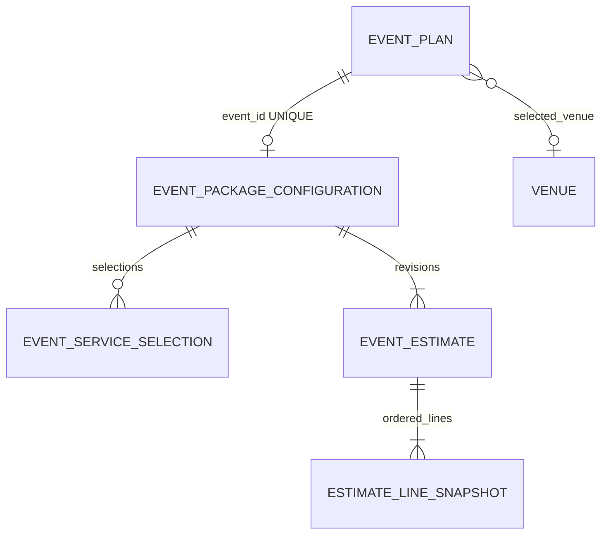
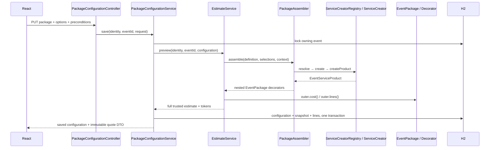

# Module 03, Phase 3 — сохранение конфигурации и снимков сметы

Проверено 11 ноября 2026 года. Исходная версия: Phase 2, коммит `d2ede96`.
Реализация сохраняет конфигурацию и неизменяемые ревизии сметы в H2, используя
существующие Factory Method и Decorator. Бронирования и платежей нет.

## 1. Обзор

В «Моих мероприятиях» → «Настроить пакет и смету» можно загрузить сохранённый
пакет, изменить услуги, рассчитать и явно сохранить новую смету. Повторное
открытие окна, обновление браузера и перезапуск Spring Boot восстанавливают
сохранённые значения. Предварительный расчёт сам по себе ничего не записывает.

Разделены три состояния: редактируемый черновик, серверный preview и последний
сохранённый снимок. Новые суммы вычисляет прежний `EstimateService`; сохранённые
суммы читаются из БД без обращения к калькулятору. Все цены остаются учебными
DEMO-ценами, а исходные `Venue.price` остаются nullable и не меняются.

## 2. Связи и развитие схемы

Добавлены только четыре таблицы. Оставлена существующая настройка
`spring.jpa.hibernate.ddl-auto=update`; новые обязательные столбцы находятся
только в новых таблицах, поэтому существующим мероприятиям не нужен backfill.
В `EventPlan` добавлен только Java-accessor даты; схема старых таблиц не меняется.
Миграционный фреймворк, destructive init, `create`/`create-drop` для рабочей БД
не добавлены. Перед рабочим обновлением приложение нужно штатно остановить и
сохранить резервную копию файлов H2. Совместимость проверена фактическим
обновлением отдельной файловой БД с JAR Phase 2 на JAR Phase 3, см. раздел 17.
Это доказательство для текущих добавляемых таблиц, а не обещание безопасности
любых будущих преобразований через Hibernate update.



| Java entity / таблица | Связи и ограничения |
|---|---|
| `EventPackageConfiguration` / `event_package_configuration` | FK event_id NOT NULL, UNIQUE(event_id), packageCode NOT NULL, `@Version Long`, revision, updatedAt |
| `EventServiceSelection` / `event_service_selection` | FK configuration_id, UNIQUE(configuration_id, service_type), enum serviceType, nullable hours |
| `EventEstimate` / `event_estimate` | FK configuration_id, UNIQUE(configuration_id, revision), `@Immutable`, контекст события, все денежные поля и версии каталогов |
| `SavedEstimateLine` / `estimate_line_snapshot` | FK estimate_id, UNIQUE(estimate_id, line_order), UNIQUE(estimate_id, code), `@Immutable`, снимок каждой строки |

Деньги хранятся как DECIMAL(16,2), процент бюджета — DECIMAL(20,2).
Суммы неизвестной аренды/итога допускают NULL; нулевая цена их не подменяет.
У обязательных отношений, кодов, источников, валюты и определённых сумм стоят
NOT NULL. Enum сохраняется строкой. Используются существующие лимиты `Money`.

## 3. Текущая конфигурация

`EventPackageConfiguration` хранит один эффективный пакет и только платные
optional selections. BASIC ничего не включает; STANDARD включает DECOR;
PREMIUM включает DECOR и HOST. Включённые услуги не становятся optional rows.
Дубликаты, null selections, лишние часы у FIXED/PER_GUEST и часы вне 1..12
отклоняются существующей pricing-проверкой и проверкой модели selections.

При замене конфигурации список сверяется по типу: существующая строка
обновляется, удалённая удаляется через orphanRemoval, новая добавляется.
Это предотвращает конфликт UNIQUE из-за порядка INSERT/DELETE при flush.
Валидация выполняется до изменения коллекции. Время нормализовано до микросекунд,
чтобы JSON до/после перечитывания H2 совпадал.

Номер `revision` начинается с 1; Hibernate `configurationVersion` начинается с 0.
Даже повторное сохранение тех же опций создаёт следующую ревизию. Клиент не
назначает версию entity: передаёт только ожидаемую версию как предусловие.

## 4. Неизменяемый снимок

`EventEstimate` фиксирует пакет, бюджет, число гостей, дату, ID площадки,
валюту, три версии каталогов, итоги/подытоги, бюджетный статус, полноту расчёта,
DEMO-признак и отпечатки входных данных. `SavedEstimateLine` фиксирует code,
название, category, pricingUnit, quantity, unitPrice, total, included,
priceSource и порядок. Тип услуги однозначно указан стабильным кодом
`SERVICE:PHOTOGRAPHY` и аналогичными кодами существующего `EstimateLine`.

Включённые строки сохраняются с нулевым начислением. Дополнительный подытог
сохранён как сумма уже вычисленных ADDITIONAL_SERVICE строк; отдельного
алгоритма ценообразования для persistence нет. Полный итог рассчитывает прежний
калькулятор. Java-объекты products/creators/decorators и имена их классов не
попадают в БД.

У snapshots нет публичных setters, денежные столбцы updatable=false,
Hibernate `@Immutable` запрещает обычный ORM dirty update. Это неизменяемость
через прикладную модель, не защита от ручного SQL администратора. При явном
удалении мероприятия удаляется и его собственная конфигурация с ревизиями;
данные остальных мероприятий не затрагиваются. Запрет удаления при будущих
бронированиях нужно добавить в Phase 4.

## 5. Атомарная транзакция

`PackageConfigurationService` имеет Spring `@Transactional`:

1. Найти принадлежащее сессии мероприятие и взять PESSIMISTIC_WRITE lock строки.
2. Проверить expected configuration version, версии каталогов и контекст события.
3. Выполнить существующий `EstimateService.preview` внутри той же транзакции.
4. Сравнить вычисленный pricingToken с preview, который видел клиент.
5. Заменить валидированный selection set и flush конфигурации.
6. Вставить новую шапку snapshot и все её строки, flush.
7. Собрать DTO; ответ передаётся после успешного commit Spring proxy.

Любая ошибка откатывает все записи, включая первый flush. Это проверено
искусственным CHECK constraint на snapshot в отдельной тестовой БД: изменение
пакета/часов/версии откатилось, старые строки и снимок полностью сохранились.
Независимых транзакций на отдельные части сметы нет.

Внутренний inverse list configuration.estimates синхронизируется при создании
snapshot и исключён из optimistic dirty versioning: у новой версии ровно один
инкремент, каскадное удаление работает и в одном persistence context.

## 6. Factory Method и Decorator



При GET `EventEstimate.value()` собирает прежний DTO из снимка. `EstimateService`,
Factory Method и Decorator не вызываются. Их исходные реализации и тесты не
переписаны; четыре существующих pattern implementations сохранены.

## 7. API

Все новые endpoints требуют существующую сессию `AuthSessions`. Владелец
берётся из `SessionIdentity`, а не JSON. Чужой и отсутствующий event дают 404.
Null-owner мероприятия доступны общему демо-профилю по прежним правилам.

| Endpoint | Результат |
|---|---|
| `GET /api/events/{id}/package` | 200; configured=false при отсутствии, иначе текущая конфигурация и последний snapshot |
| `PUT /api/events/{id}/package` | 200; create/replace, пересчёт и новая immutable ревизия |
| `GET /api/events/{id}/package/estimates` | 200; snapshot history по убыванию revision, [] при отсутствии |

GET metadata, service preview и estimate preview Phase 1/2 сохранены.
Estimate preview получил только дополнительные `eventInputToken` и
`pricingToken`; прежние поля/смысл не изменены.

## 8. Пример save/load

Ниже фактический пример HTTP на временной H2: event 6, 80 гостей, дата
2026-12-11, venue 1 (Ritz), бюджет 2000000. Сначала POST estimate/preview с
STANDARD и PHOTOGRAPHY 3 часа. Полученные версии и токены передаются в PUT.
Сессионная cookie обязательна, в примере опущена.

```http
PUT /api/events/6/package
Content-Type: application/json
```

```json
{
  "packageCode": "STANDARD",
  "services": [
    {
      "type": "PHOTOGRAPHY",
      "hours": 3
    }
  ],
  "expectedConfigurationVersion": null,
  "packageCatalogVersion": "demo-packages-v1",
  "serviceCatalogVersion": "demo-v1",
  "venueCatalogVersion": "demo-venues-v1",
  "expectedEventInputToken": "cf3a6abb896661d0e56d871c2d354f853109a46f911fa20dd4a9a8cd9835fc17",
  "expectedPricingToken": "88c2e1340a67b375547afa0c28b217a2d418676fdb091943e839aa572f859af0"
}
```

Ответ PUT и последующего `GET /api/events/6/package`:

```json
{
  "eventId": 6,
  "configured": true,
  "configurationId": 3,
  "configurationVersion": 0,
  "packageCode": "STANDARD",
  "services": [
    {
      "type": "PHOTOGRAPHY",
      "hours": 3
    }
  ],
  "savedAt": "2026-11-11T00:11:49.024008Z",
  "currentEventInputToken": "cf3a6abb896661d0e56d871c2d354f853109a46f911fa20dd4a9a8cd9835fc17",
  "currentEventInputs": {
    "date": "2026-12-11",
    "guests": 80,
    "venueId": 1,
    "budget": 2000000.0
  },
  "currentEstimate": {
    "estimateId": 8,
    "revision": 1,
    "createdAt": "2026-11-11T00:11:49.024008Z",
    "freshness": "CURRENT",
    "catalogsChanged": false,
    "eventInputs": {
      "date": "2026-12-11",
      "guests": 80,
      "venueId": 1,
      "budget": 2000000.0
    },
    "additionalServicesSubtotal": 75000.0,
    "estimate": {
      "eventId": 6,
      "venueId": 1,
      "packageCode": "STANDARD",
      "currency": "KZT",
      "quoteComplete": true,
      "demoPrices": true,
      "packageCatalogVersion": "demo-packages-v1",
      "serviceCatalogVersion": "demo-v1",
      "venueCatalogVersion": "demo-venues-v1",
      "packageSubtotal": 170000.0,
      "venueCharge": 500000.0,
      "knownSubtotal": 670000.0,
      "totalCost": 670000.0,
      "eventBudget": 2000000.0,
      "remainingBudget": 1330000.0,
      "budgetExcess": 0.0,
      "budgetUsedPercent": 33.5,
      "budgetStatus": "WITHIN_BUDGET",
      "lines": [
        {
          "code": "VENUE:1",
          "displayName": "Учебная аренда: The Ritz-Carlton, Astana",
          "category": "VENUE",
          "pricingUnit": "FIXED",
          "quantity": 1,
          "unitPrice": 500000.0,
          "total": 500000.0,
          "included": false,
          "priceSource": "DEMO",
          "currency": "KZT"
        },
        {
          "code": "PACKAGE:STANDARD",
          "displayName": "Стандарт",
          "category": "PACKAGE",
          "pricingUnit": "FIXED",
          "quantity": 1,
          "unitPrice": 95000.0,
          "total": 95000.0,
          "included": false,
          "priceSource": "DEMO",
          "currency": "KZT"
        },
        {
          "code": "SERVICE:DECOR",
          "displayName": "Декор",
          "category": "INCLUDED_SERVICE",
          "pricingUnit": "FIXED",
          "quantity": 1,
          "unitPrice": 0.0,
          "total": 0.0,
          "included": true,
          "priceSource": "DEMO",
          "currency": "KZT"
        },
        {
          "code": "SERVICE:PHOTOGRAPHY",
          "displayName": "Фотограф",
          "category": "ADDITIONAL_SERVICE",
          "pricingUnit": "PER_HOUR",
          "quantity": 3,
          "unitPrice": 25000.0,
          "total": 75000.0,
          "included": false,
          "priceSource": "DEMO",
          "currency": "KZT"
        }
      ],
      "eventInputToken": "cf3a6abb896661d0e56d871c2d354f853109a46f911fa20dd4a9a8cd9835fc17",
      "pricingToken": "88c2e1340a67b375547afa0c28b217a2d418676fdb091943e839aa572f859af0"
    }
  }
}
```

Одинаковые JSON-значения получены повторным GET. ID, timestamp и токены
зависят от тестовых данных: нельзя копировать чужой token вместо нового
preview. Для обновления этого примера expectedConfigurationVersion=0;
успех даст version=1 и revision=2. Для первого сохранения — null.
Отсутствие конфигурации возвращает configured=false, пустой services,
null configurationId/version/packageCode/savedAt/currentEstimate и актуальные
currentEventInputs/currentEventInputToken.

400: неправильные selections/пакет/часы, лишние monetary/owner/quantity поля,
числовые enum, fractional/string integer. 401: нет сессии. 404: нет доступа к
событию. 409: CONFIGURATION_CONFLICT, CATALOG_CHANGED, EVENT_CHANGED,
PRICING_CHANGED или CONCURRENT_UPDATE. Инфраструктурный constraint failure
возвращает общее 500-сообщение; SQL и stack trace не отправляются клиенту.

## 9. Конкурентность и предусловия

Сначала блокируется event. Это сериализует первое создание (ещё нет строки
configuration), обновление и согласованное чтение configuration/latest quote.
UNIQUE(event_id) — дополнительная DB-гарантия. Обновление/удаление мероприятия
в существующем EventService теперь берёт тот же lock. Изменение event не может
вклиниться между чтением контекста и сохранением snapshot.

После lock проверяется `@Version`: две вкладки с версией 0 не могут обе
сохранить version 1; второй запрос получает 409. `saveAndFlush` не заменяет
общую транзакцию. Порядок блокировок — event первым; venue lock пока не нужен.

`expectedEventInputToken` — SHA-256 нормализованных date/guests/venueId/budget.
`expectedPricingToken` включает этот контекст, selections, catalog versions и
все фактические строки/суммы расчёта. Используется length-delimited input,
денежные значения нормализованы существующим Money. Поэтому даже изменение
цены без bump версии обнаруживается при save. Все три expected catalog versions
обязательны. Хеши служат предусловиями согласованности, не авторизацией и не
клиентской доверенной ценой. Сервер всегда считает заново под блокировкой.

## 10. Свежесть относительно мероприятия

`CURRENT`: сохранённые date, guests, venueId и budget совпадают с текущим
мероприятием. `OUTDATED`: отличается хотя бы одно поле. Сравнение бюджета
не зависит от BigDecimal scale. Старые суммы и бюджетный статус не меняются;
UI помечает их историческими и просит новый расчёт.

Название, описание и strategy не участвуют: текущие цены от них не зависят.
Если пользователь вернул все расчётные параметры к исходным, CURRENT снова
обоснован. Эта модель сравнивает значения, а не абсолютную ревизию мероприятия.

Отдельный `catalogsChanged` сравнивает сохранённые версии с текущими версиями
метаданных, не пересчитывая историческую смету. Изменение каталогов само по себе
не заменяет snapshot. Для корректного уведомления о смене цен нужно повышать
catalogVersion; save дополнительно защищён pricingToken даже при нарушении
этого правила. CURRENT не обещает актуальность новых тарифов или наличие брони.

## 11. История и явный пересчёт

GET возвращает сохранённые цены независимо от новых каталогов. Проверены:

- BASIC + photography 2h: 580000 при 25000/час; новый preview при 30000/час
  равен 590000, старая ревизия остаётся 580000.
- Реальный restart: STANDARD + photography 3h = 670000. После перезапуска с
  изменёнными TEST-каталогами (30000/час и аренда 550000) старый snapshot и
  строки остаются 670000. Явный preview/save даёт 735000 и revision 2.

История минимальна: read-only endpoint без редактирования, удаления отдельных
ревизий и отдельного UI. Конфигурация содержит текущие selections; исторические
line quantities и коды фиксируют оплаченный состав прошлой сметы.

## 12. React: загрузка, черновик, preview, save

Расширен прежний `PackageConfigurator`, второго редактора нет. При открытии
загружаются package/service metadata и GET package. Saved selection восстанавливает
package/hours, а `EstimateBreakdown` показывает «Сохранённая смета». До save
новый расчёт подписан «Предварительный расчёт» и «данные пока не сохранены».

Кнопка «Сохранить смету» доступна после актуального server preview.
Чистым помечается только тот local draft revision, который действительно
сохранён. Изменение выбора во время PUT разрешено: ответ обновит saved baseline
и expected version, но не заменит более новый черновик/preview. Повторный PUT
до окончания запроса блокируется. Обычная 400/сетевая ошибка сохраняет draft.

Preview abort/revision guard защищает от старого ответа. Закрытие/смена event
отменяет запросы; редактор keyed по event.id. При 409 предлагается явно
обновить saved baseline, сохранив draft, затем сделать новый preview. Никакой
автоматической перезаписи чужой версии. 401 использует существующий auth flow.
Прерывание HTTP после commit не отменяет серверный commit: повторное открытие
загрузит фактически сохранённый результат.

Политика Phase 2 сохранена: optionalDraft внутри открытого окна паркует DECOR/
HOST при переключении в пакет с включением, отфильтровывая их из платного запроса.
При обратном переключении восстанавливаются намерение и часы. В БД записывается
только эффективный выбор. После закрытия неоплаченная скрытая история намерений
не сохраняется; следующий open начинается с сохранённой конфигурации.

Исторический snapshot может оставаться видимым при изменении draft, но явно
помечен сохранённым и сопровождается «Есть несохранённые изменения». Старый
preview инвалидируется. OUTDATED не выдаётся за актуальный итог для event.
Сохранённая over-budget смета допустима и продолжает показывать предупреждение.

## 13. Файлы

Java-пути относительно `backend/src/main/java/kz/qonaqai/`.

| Новые файлы | Назначение |
|---|---|
| domain/estimate/EventPackageConfiguration.java | Одна конфигурация на событие, version, reconcile selections |
| domain/estimate/EventServiceSelection.java | Валидированные эффективные optional selections |
| domain/estimate/EventEstimate.java | Неизменяемая ревизия итогов и контекста |
| domain/estimate/SavedEstimateLine.java | Неизменяемые упорядоченные строки |
| domain/estimate/EventInputSnapshot.java | Embedded event context и freshness |
| domain/estimate/EstimateTokens.java | Нормализованные отпечатки предусловий |
| domain/estimate/PackageConflictException.java | Понятные коды 409 |
| persistence/PackageConfigurationRepository.java | Поиск текущей конфигурации |
| persistence/EventEstimateRepository.java | Latest/history revisions |
| service/PackageConfigurationService.java | Транзакционные load/save/history |
| web/PackageConfigurationController.java | Строгий HTTP DTO contract |

Изменены: EventPlan (date accessor), EventRepository (owned row lock),
EventService (координация edit/delete и каскад удаления), EstimateService (tokens),
ApiErrors (409/санитизированная ошибка persistence).

Frontend: PackageConfigurator.jsx, EstimateBreakdown.jsx,
package-configurator.css; main.jsx только сохраняет response error.code.
Новые тесты: SavedConfigurationTest, EstimateSnapshotTest,
PackagePersistenceIntegrationTest, PackageConcurrencyIntegrationTest.
Новые скрипты: scripts/check-estimate-restart.py,
scripts/check-saved-estimate-ui.mjs. Обновлены README, architecture/testing и
историческая ссылка Phase 2. Pricing resources, dependencies, исходные venue
цены, прежние pattern/test files не менялись.

## 14. Автоматические тесты

| Новый класс | Выполнено | Что проверено |
|---|---:|---|
| SavedConfigurationTest | 6 | Создание/замена/revision, reconcile, uniqueness, inclusion, часы, stale version, freshness |
| EstimateSnapshotTest | 1 | Frozen BigDecimal rates/lines/context после изменения configuration/event, сумма строк |
| PackagePersistenceIntegrationTest | 24 | BASIC/STANDARD/PREMIUM, selections, snapshot/history, all four freshness inputs, expected versions/tokens, strict JSON, ownership/demo, UNKNOWN rent, отсутствие пересчёта при GET, catalog price change |
| PackageConcurrencyIntegrationTest | 4 | Две независимые транзакции initial/update, rollback после настоящего constraint failure, event-edit/save row-lock coordination |
| **Новые** | **35** | **Все прошли** |
| Прежние Phase 1/2 | 172 | Без изменения тестов; Strategy/Observer/Factory/Decorator и прежние endpoints |
| **Итого** | **207** | **0 failures, 0 errors, 0 skipped; 92 unit + 115 integration** |

Concurrency-тесты не обёрнуты одним rollback-only test transaction; потоки
используют отдельные Spring-транзакции/соединения. Остальные интеграционные
проверки работают с изолированными H2. Рабочая backend/data не открывалась.

## 15. Фактические команды и результаты

Из backend (локальный Maven cache уже существовал):

```sh
mvn -o -B -Dmaven.repo.local=/home/morninginheaven/aitu/sdp/QonaqAI/.tools/m2 test-compile
mvn -o -B -Dmaven.repo.local=/home/morninginheaven/aitu/sdp/QonaqAI/.tools/m2 test
mvn -o -B -Dmaven.repo.local=/home/morninginheaven/aitu/sdp/QonaqAI/.tools/m2 package
```

Java release 21: PASS. Финальный `package`: **207/207**, BUILD SUCCESS,
исполняемый backend/target/qonaqai-0.1.0.jar. Test-only итерации выполнялись
раньше финального package; итоговые числа относятся к последнему package.
Frontend `npm run build`: PASS, Vite 29 modules. Новые зависимости не установлены.

При первом полном прогоне найдена ошибка синхронизации inverse JPA-коллекции
при каскадном удалении и ошибочное expected значение нового теста (600000 вместо
590000); оба исправлены. Дополнительная UNKNOWN-rent fixture первоначально имела
ошибку Java escaping; исправлена. Старые тесты не ослаблялись. Test-compile не
использован как замена запуску тестов.

JUnit XML: backend/target/surefire-reports. Временные логи проверки находились
в /tmp/qonaqai-persistence-{package,restart,browser,previous-browser}.log;
это локальные артефакты выполнения, в Git они не добавлены. Обязательных
заблокированных проверок нет.

## 16. Firefox и адаптивность

Собранный JAR скопирован в неизменяемый test-owned /tmp JAR и запущен на 18087
с `QONAQ_DB_URL=jdbc:h2:mem:saved-ui;DB_CLOSE_DELAY=-1`. Firefox BiDi запускался
с отдельным профилем /tmp и портом 19227. Пример команд:

```sh
firefox --headless --no-remote --profile /tmp/qonaqai-persistence-firefox --remote-debugging-port 19227 about:blank
QONAQ_UI_TEST_BASE_URL=http://127.0.0.1:18087 QONAQ_BIDI_URL=ws://127.0.0.1:19227/session node scripts/check-estimate-ui.mjs
QONAQ_UI_TEST_BASE_URL=http://127.0.0.1:18087 QONAQ_BIDI_URL=ws://127.0.0.1:19227/session node scripts/check-saved-estimate-ui.mjs
```

Скрипты запускаются последовательно; требуются уже запущенные безопасный
сервер и Firefox. Новый script требует явный BASE_URL, создаёт собственный
аккаунт и тестовые события. Не направлять проверки на пользовательскую БД.

Прежние **8 групп PASS**: BASIC 1350000/650000/67.5%, включения, optional-draft,
часовые ошибки/повторная отправка/старый preview, 390 px, over-budget,
close/event-switch, no venue/session expiry.

Новые **5 групп PASS**:

1. STANDARD + photo 3h → 670000; save, close/reopen и полный reload.
2. PREMIUM; две вкладки, stale PUT → 409, refresh сохраняет local draft.
3. Duplicate save подавлен; delayed PUT не затирает PREMIUM/photo4/catering;
   обычная validation error сохраняет draft, retry успешен.
4. Guest edit 80→90: старые 1425000 остаются OUTDATED, новый save 1505000 CURRENT.
5. Over-budget смета сохраняется/восстанавливается; desktop 1280, tablet 768 и
   mobile 390 без горизонтального overflow. Мобильный screenshot просмотрен.

Первый браузерный перезапуск потребовался из-за пересборки JAR, из которого
ещё работал тестовый JVM (classloading failure). Итоговые проверки выполнены
повторно из отдельной неизменяемой копии JAR. Проблема тестового запуска не
обходилась изменением production поведения. Тестовые процессы остановлены.

## 17. Реальный файловый H2 restart и обновление Phase 2

```sh
python3 scripts/check-estimate-restart.py --baseline /tmp/qonaqai-phase2-baseline.jar
```

Baseline — сохранённый до изменений Phase 2 JAR. Для повторения сохраните его
отдельно перед сборкой Phase 3 либо соберите исходный Phase 2 в отдельном checkout.
Нужны Java 21, свободный порт (по умолчанию 18086), Python stdlib; дополнительных
пакетов нет. Скрипт сам делает frozen copy нового JAR и останавливает свои JVM.

**5 групп PASS**, четыре последовательных отдельных процесса Java с общей
временной файловой H2:

1. Phase 2 создаёт account/event/venue/notifications в TemporaryDirectory.
2. Phase 3 добавляет новые таблицы; bootstrap исходных сущностей не изменился,
   все factual prices остались null; сохранён STANDARD + photo3 = 670000.
3. Полный stop/start JVM с тем же file URL; весь GET JSON совпал, включая
   estimate ID, version, revision, selections, дату, rates, порядок lines и суммы.
4. Третий вариант Phase 3 JAR с изменёнными только внутри test-owned копии
   service/venue ресурсами: старая смета 670000 неизменна; catalogsChanged=true;
   старые expected versions дают 409; явное сохранение 735000 создаёт revision 2,
   history сохраняет revision 1.
5. Все проверки завершены; пользовательская H2 не открывалась. TemporaryDirectory
   удаляет только собственные файлы после остановки всех дочерних JVM.

Это проверка отдельных процессов и дисковой H2, а не имитация restart на in-memory DB.

## 18. Ограничения

- Сессия остаётся существующей серверной сессией; после restart нужно снова
  войти. Accounts/configuration/quotes при этом сохраняются.
- CURRENT сравнивает pricing-relevant input values, а catalog warning — версии.
  Каталоги неизменяемы на время процесса и должны версионироваться при изменении.
- Existing EventPlan PUT не получил новый клиентский expected-version contract.
  Его edit/delete согласованы с quote locks, но задача общей защиты старого
  редактора мероприятия от last-writer-wins остаётся отдельным улучшением.
- History endpoint не пагинирован; для локального учебного проекта достаточно.
  Отдельного history UI и сохранения скрытого optional draft нет.
- Snapshot неизменяем в прикладной модели; явное удаление parent event удаляет
  его историю. Юридического архива, аудита администраторов и booking пока нет.
- Неизвестная DEMO-аренда сохраняет incomplete quote с null total и UNKNOWN line;
  он не должен считаться готовым подтверждённым расчётом для будущего booking.
- Стоимость аренды/услуг учебная, не предложение реального поставщика.

## 19. Phase 4 — Booking

Будущий Booking должен ссылаться на тот же EventPlan и конкретный EventEstimate
ID/revision, а не только на плавающую текущую configuration. Подтверждение
должно повторно проверить владельца, CURRENT input context, полноту quote,
политику допустимых catalog versions и version конфигурации в транзакции.
Исторический snapshot сам по себе не гарантирует доступность площадки.

Сначала lock event, затем при необходимости venue — единый порядок для всех
будущих операций. Проверка временных пересечений и вставка Booking должны быть
атомарными в БД. При наличии брони пересмотреть hard-delete мероприятия и
каскад quote history. Ни один из этих booking механизмов пока не реализован.
