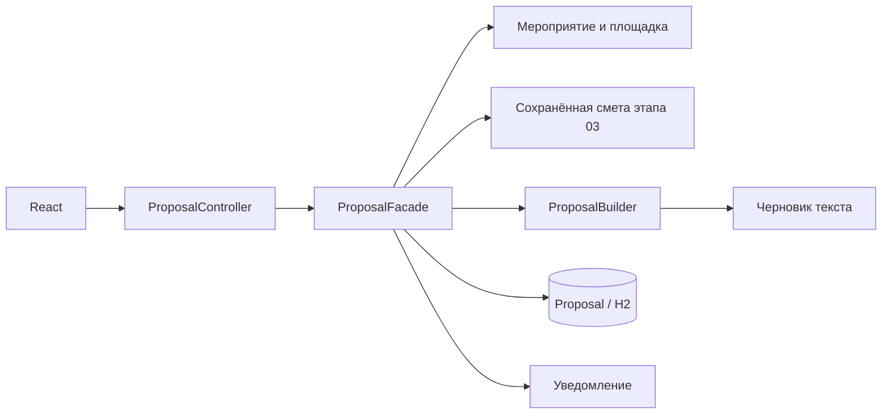

# Этапы 05 и 06 — часть Дастана

## Реализованное поведение

05: свободное описание → редактируемые подсказки → сохранённое мероприятие →
выбранная площадка → сохранённая смета → редактируемое предложение → сохранение.
06: личный кабинет с проектами, состоянием смет, предложениями, бронированиями и
уведомлениями; сохраняемый демонстрационный Free/Pro.

`PlanningAssistant` — локальный демонстрационный провайдер `DEMO_RULES`, а не
подключённая внешняя нейросеть. Он выделяет тип, дату, гостей, бюджет и стратегию.
Поддерживаются числовые даты, «20 декабря 2027», «завтра», «послезавтра», бюджеты
«2 000 000», «2,5 млн», «500 тыс». Неизвестные параметры не придумываются;
невозможные и прошлые даты не подставляются. Ответ не сохраняет мероприятие.
Подсказки пользователь проверяет в существующей форме. Публичные характеристики
площадок и расчёты Java остаются источником данных.

Предложение строится только из сохранённой актуальной сметы. При неизвестной цене
аренды текст показывает известную часть и необходимость уточнения цены.
Изменение текста не пересчитывает смету и не подтверждает бронь. Поля документа
выводятся React как текст; HTML из пользовательских строк не исполняется.

Документ хранит владельца, ID мероприятия и сметы, версию, исходный токен,
известную сумму, полноту расчёта и редактируемый текст. Токен связывает документ
с названием/типом события и конкретной сохранённой сметой. Старый черновик нельзя
сохранить после изменения источника. Ранее сохранённый документ остаётся доступен
с отметкой `OUTDATED`; удаление мероприятия оставляет его с `EVENT_REMOVED`.
Редактирование проверяет `expectedVersion` и JPA `@Version`.

## Паттерны для защиты

**Facade:** `patterns/facade/ProposalFacade.java`. Контроллер вызывает одну операцию
`draft` или `create`, а фасад координирует владельца, мероприятие, площадку,
сохранённую смету, Builder, сохранение документа и уведомление. Расчёт стоимости
переиспользуется из этапа 03. Фасад не заменяет Factory Method и Decorator.

**Builder:** `patterns/builder/ProposalBuilder.java`. Цепочка
`event(...).venue(...).estimate(...).demoTerms().build()` пошагово составляет
предложение из разных разделов. Фасад задаёт порядок сборки. Builder не получает
цены из текста пользователя: строки и суммы берутся из сохранённой сметы.

## Тарифы

| Возможность | Free | Pro |
|---|---|---|
| Мероприятия, сметы, DEMO-брони, помощник | Да | Да |
| Сохранённые предложения | До 3 | До 100 |
| Редактирование сохранённых документов | Да | Да |
| Выгрузка TXT | Нет | Да |
| Платёж | Нет | Нет — показана условная DEMO-цена |

Новые аккаунты начинают с Free. Тариф хранится отдельно в `AccountPlan`, поэтому
старые аккаунты получают Free без изменения пароля и данных. При переходе на Free
существующие документы не удаляются; блокируется создание сверх лимита.
Лимит проверяет сервер под блокировкой аккаунта, общей для всех его мероприятий.
Смена тарифа использует ту же блокировку. Общий демо-профиль не меняет тариф и не
сохраняет предложения; личный кабинет разделяет данные по аккаунтам.

## API

Все маршруты требуют существующую серверную сессию. Доступ к документам и
мероприятиям проверяется по владельцу; чужой объект возвращает 404.

| Метод и маршрут | Назначение |
|---|---|
| POST `/api/assistant/suggest` | `{text}` → `{provider,fields,missing,warnings}` |
| POST `/api/events/{id}/proposal-draft` | Черновик без сохранения |
| POST `/api/events/{id}/proposals` | `{title,body,sourceToken}` → сохранение |
| GET `/api/proposals` | Документы текущего владельца |
| GET `/api/proposals/{id}` | Документ и состояние исходных данных |
| PUT `/api/proposals/{id}` | `{title,body,expectedVersion}` → редактирование |
| GET `/api/proposals/{id}/export` | TXT; Pro, проверка владельца |
| GET `/api/plans` | Демонстрационные возможности Free/Pro |
| GET/PUT `/api/account/plan` | Тариф / смена через `{code:"PRO"}` |
| GET `/api/account/dashboard` | Проекты, сметы, предложения, брони, уведомления |

Ошибки: 400 — неверные поля; 401 — нет сессии; 403 — ограниченная возможность;
404 — объект отсутствует или принадлежит другому аккаунту;
409 — устаревший источник, версия документа или превышение лимита.

## Проверка

Автотесты: `PlanningAssistantTest` (распознавание и неизвестные поля),
`ProposalIntegrationTest` (полный документ, хранение, изоляция, устаревание,
версии, неизвестная аренда), `AccountDashboardIntegrationTest` (тариф,
лимиты, экспорт, кабинет, брони, демонстрационный профиль и одновременные сохранения).
Существующие тесты этапов 01–04 запускаются вместе с ними.

Ручной сценарий:

1. Создать личный аккаунт и отправить описание с будущей датой.
2. Исправить распознанное число гостей; проверить неизвестные поля на другом описании.
3. Сохранить мероприятие, выбрать площадку, рассчитать и сохранить смету.
4. Подготовить предложение, изменить текст и сохранить его.
5. Открыть личный кабинет и повторно открыть сохранённый документ.
6. Обновить смету: старое предложение должно получить отметку устаревания.
7. Достичь трёх предложений на Free; четвёртое блокируется. Выбрать Pro и повторить.
8. Скачать TXT на Pro. Вернуться на Free: документы остаются, выгрузка недоступна.
9. Проверить подтверждение и отмену DEMO-брони в кабинете и уведомлениях.
10. Перезапустить сервер, войти снова и проверить документы и выбранный тариф.

Результаты текущего прогона фиксируются в `docs/MODULES_05_06_VALIDATION.md`.
Исторический `PROJECT_REVIEW.md` описывает состояние до этих изменений.
