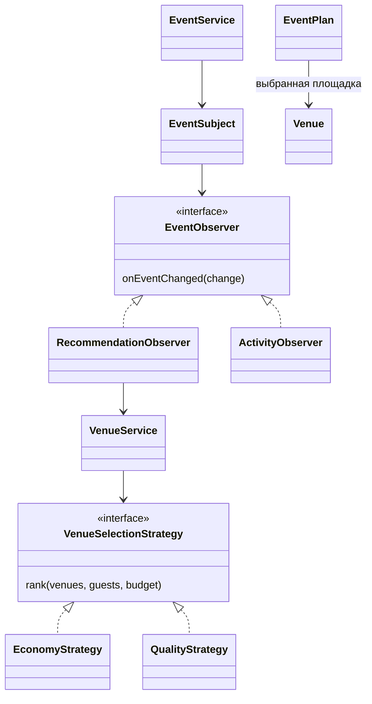
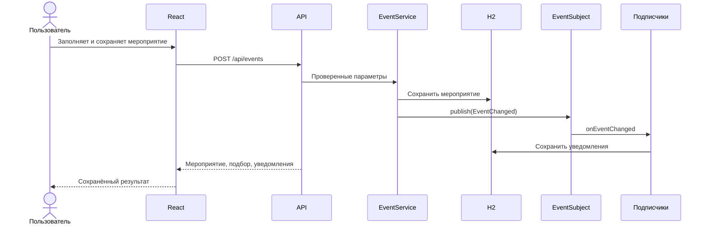

# Архитектура первых двух этапов

React отображает каталог и форму. REST API на Java принимает запросы, проверяет ввод и вызывает сервисы. Spring Data JPA сохраняет аккаунты, площадки, мероприятия и уведомления в файловой H2. Серверная сессия связывает запросы с аккаунтом. Сохранённые мероприятия и уведомления выдаются только их владельцу. Общий демо-профиль открывает данные без владельца из прежней версии.

## Strategy

`VenueSelectionStrategy` задаёт общий интерфейс. `EconomyStrategy` сначала сравнивает известные цены, затем запас банкетных мест. `QualityStrategy` сравнивает площадь зала на гостя. `VenueService` выбирает реализацию по параметру пользователя. Никаких выдуманных цен, рейтингов или гарантий экономии нет. При неопубликованных тарифах бюджет не подтверждает доступность площадки.

## Observer

`EventService` сохраняет мероприятие и сообщает об изменении через `EventSubject`. Подписчик `RecommendationObserver` пересчитывает подбор и сохраняет уведомление с количеством вариантов. Независимый `ActivityObserver` сохраняет сообщение о создании или изменении. Оба работают в одной транзакции с мероприятием. Реализация паттерна находится в проекте; Spring только создаёт и связывает объекты.

## Передача следующих этапов

Бейбарыс добавляет пакеты, услуги, расчёт и Factory Method/Decorator. Дастан добавляет бронирование, ИИ, предложение и Facade/Builder. Стоимость услуг должна рассчитываться в Java. Выбор площадки на этом этапе не является бронированием.

Данные площадок и ссылок находятся в `backend/src/main/resources/catalog.json`. Для расширения до 50 добавьте проверенные записи с уникальными стабильными ID и фотографии в `static/images`. При старте каталог обновляется по ID, мероприятия сохраняются. Для многопользовательского публичного размещения потребуются отдельные пользователи, авторизация, миграции и серверная БД; текущая версия предназначена для локальной демонстрации.
