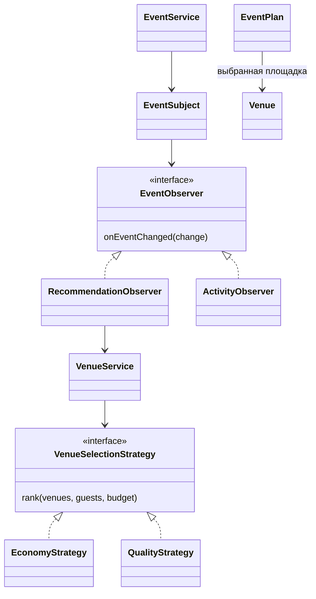
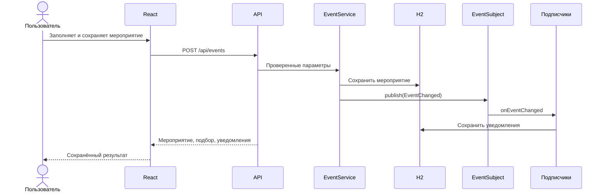

# Архитектура QonaqAI

React отображает каталог и форму. REST API на Java принимает запросы, проверяет ввод и вызывает сервисы. Spring Data JPA сохраняет аккаунты, площадки, мероприятия и уведомления в файловой H2. Серверная сессия связывает запросы с аккаунтом. Сохранённые мероприятия и уведомления выдаются только их владельцу. Общий демо-профиль открывает данные без владельца из прежней версии.

## Strategy

`VenueSelectionStrategy` задаёт общий интерфейс. `EconomyStrategy` сначала сравнивает известные цены, затем запас банкетных мест. `QualityStrategy` сравнивает площадь зала на гостя. `VenueService` выбирает реализацию по параметру пользователя. Никаких выдуманных цен, рейтингов или гарантий экономии нет. При неопубликованных тарифах бюджет не подтверждает доступность площадки.

## Observer

`EventService` сохраняет мероприятие и сообщает об изменении через `EventSubject`. Подписчик `RecommendationObserver` пересчитывает подбор и сохраняет уведомление с количеством вариантов. Независимый `ActivityObserver` сохраняет сообщение о создании или изменении. Оба работают в одной транзакции с мероприятием. Реализация паттерна находится в проекте; Spring только создаёт и связывает объекты.

## Factory Method — дополнительные услуги (Module 03, Phase 1)

Сервер загружает версионированный DEMO-каталог из
backend/src/main/resources/service-rates.json. Фактические цены площадок не
меняются. Публичный GET /api/service-options отдаёт метаданные, а
POST /api/events/{eventId}/services/preview проверяет сессию/владельца и
считает только дополнительные услуги без записи в БД.

ServicePreviewService использует EventRepository и сохранённое число гостей.
Для каждого выбора он вызывает ServiceCreatorRegistry → ServiceCreator.create()
→ конкретный createProduct() → конкретный EventServiceProduct. В проекте
пять продуктов и пять создателей: ведущий, фотограф, декор, музыка, питание.
Арифметика выполняется в Java через BigDecimal. Реестр не является фабричным
методом; фабричный метод явно переопределён в каждом Creator.

В Phase 1 React открывал отдельный ServicePreviewPanel. В Phase 2 его место
занял единый PackageConfigurator, а прежний REST endpoint расчёта услуг
сохранён без изменений. Phase 3 добавляет явное сохранение пакета и снимков
сметы; устаревшие запросы отменяются. Бронирование реализовано в Module 04, см. ниже.

Участники, API, правила, диаграмма и результаты проверок:
[FACTORY_METHOD_IMPLEMENTATION.md](FACTORY_METHOD_IMPLEMENTATION.md).

## Decorator — пакеты и предварительная смета (Module 03, Phase 2)

EventPackage задаёт общий контракт cost()/lines() и наборы включённых/выбранных
услуг. BasicPackage, StandardPackage и PremiumPackage используют доверенные
определения из package-rates.json. PackageServiceDecorator содержит wrapped
EventPackage и существующий EventServiceProduct. Пять конкретных декораторов
проверяют тип продукта, а общая обёртка складывает стоимость и детализацию.

PackageAssembler создаёт продукты через прежний Factory Method и строит
реальную цепочку обёрток. EstimateService вызывает внешние cost() и lines(),
после чего ровно один раз добавляет аренду из отдельного
demo-venue-rates.json. Фактические Venue.price и CatalogSeeder не меняются.

GET /api/package-options публичен; POST /api/events/{id}/estimate/preview
проверяет сессию/владельца, использует сохранённые гостей/бюджет/площадку,
возвращает строки и бюджетный статус. Если DEMO-аренда неизвестна, итог null,
quoteComplete=false; достаточность бюджета не объявляется по частичной сумме.

React открывает PackageConfigurator через «Настроить пакет и смету».
Отдельный optional-черновик переживает переключение пакета внутри окна;
включённые типы исключаются из платного запроса. EstimateBreakdown форматирует
серверный ответ. Сам preview по-прежнему ничего не записывает; сохранение
Phase 3 реализовано отдельной транзакционной операцией ниже.

Полная схема, тарифы, API, проверенные примеры и план сохранения:
[DECORATOR_IMPLEMENTATION.md](DECORATOR_IMPLEMENTATION.md).

## Сохранение пакета и сметы (Module 03, Phase 3)

React → PackageConfigurationController → PackageConfigurationService → JPA → H2.
Новые EventPackageConfiguration и EventServiceSelection хранят текущий выбор;
EventEstimate и SavedEstimateLine — immutable pricing snapshots по ревизиям.
UNIQUE(event_id) и @Version защищают конфигурацию, FK/уникальные selection и
line codes — состав. Существующие event/account/venue/notification таблицы
не меняются; Hibernate update добавляет только новые таблицы. Реальный upgrade
с предыдущего JAR и restart проверены на отдельной файловой H2.

PUT /api/events/{id}/package берёт owned-event row lock, проверяет expected
version/три catalog versions/event и pricing tokens, вызывает существующий
EstimateService → Factory Method → Decorator и атомарно сохраняет результат.
GET /package и /package/estimates читают только frozen monetary snapshot.
Edit/delete event используют тот же root lock; новая схема EventPlan не нужна.
Дата/гости/venue/budget snapshot сравнивается с текущим event: CURRENT/OUTDATED.
Catalog version drift отмечается отдельно; история не пересчитывается.

PackageConfigurator восстанавливает saved state, сохраняет явно и различает
черновик/preview/saved. Поздний save не затирает более новый draft, 409 требует
явного обновления baseline. В БД нет Java decorator graphs.
Полная модель, ER, API и фактические проверки:
[ESTIMATE_PERSISTENCE_IMPLEMENTATION.md](ESTIMATE_PERSISTENCE_IMPLEMENTATION.md).

## Передача следующих этапов

Factory Method, Decorator, пакеты, полная смета и сохранение конфигураций/снимков реализованы. Module 04 добавляет бронирование. ИИ, предложение и Facade/Builder остаются будущими задачами. Стоимость услуг должна рассчитываться в Java. Выбор площадки на этом этапе не является бронированием.

Данные площадок и ссылок находятся в `backend/src/main/resources/catalog.json`. Для расширения до 50 добавьте проверенные записи с уникальными стабильными ID и фотографии в `static/images`. При старте каталог обновляется по ID, мероприятия сохраняются. Для многопользовательского публичного размещения потребуются отдельные пользователи, авторизация, миграции и серверная БД; текущая версия предназначена для локальной демонстрации.

## Module 04 — Booking

BookingService подтверждает и отменяет брони в одной транзакции с locks
PESSIMISTIC_WRITE в порядке EventPlan → Venue. Строка Venue защищает даже
пустое расписание. Проверка пересечений CONFIRMED и INSERT атомарны.
Одна активная бронь event дополнительно защищена nullable unique key.
Бронь принимает только актуальную полную сохранённую ревизию сметы, фиксирует
её ID/ревизию/сумму. Интервалы UTC, дата события проверяется в Asia/Almaty.
Изменения event/package, несовместимые с CONFIRMED, отклоняются; отмена
освобождает слот, история сохраняется. React BookingPanel находится под
сохранённой сметой, BookingHistory показывает все брони владельца.
Модель, API, lifecycle, locking и ограничения:
[BOOKING_IMPLEMENTATION.md](BOOKING_IMPLEMENTATION.md).
